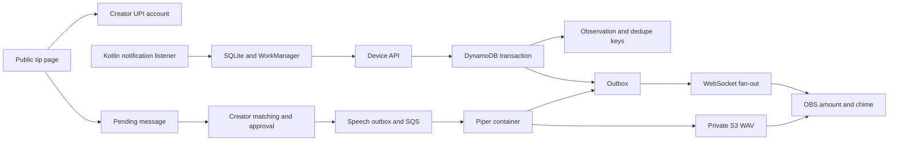

# Architecture

The user’s production prompt takes precedence over the attached architecture brief. Cognito and tenant isolation are implemented for deployed environments. The no-sign-in creator exists only in explicit loopback local mode.

## Boundaries and credentials

The HTTP API verifies Cognito access tokens, including issuer, client and token use. API Gateway also applies a Cognito JWT authorizer to dashboard, account, admin, and device-pairing routes. Creator IDs come from the token `sub`, never request data. Local bypass requires all of `APP_ENV=local`, `LOCAL_AUTH_BYPASS=true`, host `127.0.0.1`, and no AWS runtime indicators. AWS development stacks require Cognito too.

Device tokens and overlay secrets are independently generated 256-bit random values. Only SHA-256 lookup hashes are stored. A pairing code has 48 bits of entropy, a five-minute TTL and a conditional single-use flag. Pairing is rate-limited by IP and requires a Google-authenticated creator whose subject matches the code owner. Device revoke changes both the creator’s device record and credential lookup atomically.

The OBS secret lives in a URL fragment, is never included in an HTTP request URL, and is exchanged using an Authorization header for a 30-second single-use ticket. Tickets are consumed transactionally on WebSocket connection. Socket URLs contain tickets, so access logging deliberately excludes query strings and headers. Rotation increments the creator’s overlay version. Publication and replay check the version for every connection, including existing sockets.

## Durable data and access patterns

`pk` and `sk` form the primary key. `version` supports optimistic conditional writes. The Dynamo adapter uses consistent reads and transactional puts. The local file adapter commits an entire transaction through atomic rename and supports one process.

| Partition                                                 | Sort keys                                         | Purpose                                             |
| --------------------------------------------------------- | ------------------------------------------------- | --------------------------------------------------- |
| `CREATOR#sub`                                             | `PROFILE`                                         | Settings, overlay generation and deletion tombstone |
| `CREATOR#sub`                                             | `OBS#alertId`, `EVENT#device#eventId`, `REF#hash` | Observation and retry/reference deduplication       |
| `CREATOR#sub`                                             | `ALERT#id`, `OUTBOX#id`, `OUTBOX#job-id`          | Replayable alerts and durable publication jobs      |
| `CREATOR#sub`                                             | `MESSAGE#id`, `JOB#id`                            | Pending/reviewed text and speech lifecycle          |
| `CREATOR#sub`                                             | `DEVICE#id`, `CONNECTION#id`                      | Tenant-scoped diagnostics and fan-out               |
| `DEVICE#hash`, `OVERLAY#hash`, `TICKET#hash`, `PAIR#hash` | `AUTH` or `CODE`                                  | Scoped credential resolution                        |
| `SLUG#slug`, `CONNECTION#id`                              | `LOOKUP`                                          | Public creator and connection lookup                |
| `RATE#scope-hash#time-bucket`                             | `COUNT`                                           | Conditional rate counters                           |

Observations, messages, dedupe entries, jobs and alerts retain seven days. Pairing codes expire after five minutes, tickets after 30 seconds, and connections after two hours. Application checks enforce expiry even before DynamoDB TTL deletion. Short rate buckets expire automatically. Audio expires from S3 after one day, with signed GET URLs valid for 60 seconds. Creator settings and active credential metadata remain until deletion. Rotated credential hashes can be removed by the deletion runbook. Backups follow DynamoDB recovery retention.

Dashboard reads query a single creator partition. Fan-out queries only that creator’s connections. A sparse `outbox` GSI indexes pending rows for the scheduled repair worker. There is no global scan in alert delivery. The current dashboard queries seven days of tenant data in one response, so load testing must establish safe creator volume before launch. Pagination is a future scale requirement if that bound becomes too large.

## Delivery semantics

The observation, device/event dedupe key, optional creator/reference dedupe key, alert and outbox are committed together. Conflicting references with unequal amounts are rejected. Equal amounts alone never deduplicate. Seven-day dedupe retention exceeds the one-day upload acceptance window. A phone retry preserves its original ID and time.

DynamoDB Streams trigger dispatch. A one-minute GSI repair pass recovers missed or exhausted stream attempts. Dispatch marks an outbox sent only after publication or enqueue succeeds. Retrying can deliver the same stable alert ID multiple times. The overlay marks it in localStorage before playback and rejects duplicates and expired entries. If localStorage fails, processing fails closed rather than replaying an untracked alert.

When OBS is disconnected, alerts remain available for replay until their two-minute deadline. A `ready` message on connect and every 25 seconds requests unexpired alerts. Outbox delivery and replay use the same materialization path. Older events remain visible in dashboard history but never play. At-most-once playback sacrifices completing a partially played sound after a page crash. Clearing OBS browser storage can remove the dedupe history, so do not clear it during the replay window.

## Moderated speech

Messages start pending. Automatic linking requires one same-creator observation and one non-rejected message for a 12-digit UPI reference, plus equal amount when provided. Missing, conflicting or ambiguous references require explicit selection of a creator-owned observation. Manual approval rejects unequal amounts and reuse of an already approved observation. A reference is user-supplied and cannot prove sender identity, so all speech requires creator review.

Approval and the speech outbox commit together. SQS carries creator/job identifiers only. The worker fetches approved text from DynamoDB, validates approval and creator state again at completion, and commits the stable speech alert plus outbox atomically. The model version is part of the job ID. Synthesis retries can duplicate compute but cannot create a second playback ID. Expired jobs stop without audio publication. Failed synthesis retries to a DLQ. Local mode records speech failures directly. Chime and speech have separate browser playback queues and deadlines.

## Privacy and limitations

The Kotlin service reads only the allowlisted package and uploads only the normalized contract. Raw notification bodies are never persisted by TipRelay. At the creator’s request, normalized payer names are now included in observations and expiring speech jobs for spoken payment announcements. The app may miss notifications or receive a format without the receiving UPI identity. Use a dedicated creator payment identity and clearly communicate that alerts do not establish settlement. Device credentials can fabricate observations if compromised, making device revocation essential.

Structured logs include event names, request/job correlation IDs, timings and status. They exclude request bodies, bearer tokens, query strings, references and viewer text. Web text is rendered through React text nodes. Payload size, amount, text length and durable rate limits apply at boundaries.

## Google identity and admin roles

Cognito federates Google through separate PKCE clients for web and Android. New application profiles have the user role; only an IAM-authorized operator can bootstrap an admin. Admin reads and writes check the stored actor role, never client claims or request bodies. Ban/deletion state is checked by tenant access, device ingestion, socket publication/replay and speech. Account directory pages use a separate registry partition and return only account metadata. See `google-login-and-admin.md` for limits, deployment values, and release checks.
